<!-- aspire488 · profile README. Notebook pages: scripts/render_profile_notebook.py. Design notes: docs/DESIGN.md. Live cards are redrawn by .github/workflows/profile-cards.yml -->

<h1>
  <picture>
    <source media="(prefers-color-scheme: dark)" srcset="./assets/profile/hero.dark.svg">
    <source media="(prefers-color-scheme: light)" srcset="./assets/profile/hero.light.svg">
    
  </picture>
</h1>

hey, I'm Joel 👋 I learn by building things, shipping them, and finding out why they break. Here's what's on my desk.

## Shipped

<picture>
  <source media="(prefers-color-scheme: dark)" srcset="./assets/profile/pipo.dark.svg">
  <source media="(prefers-color-scheme: light)" srcset="./assets/profile/pipo.light.svg">
  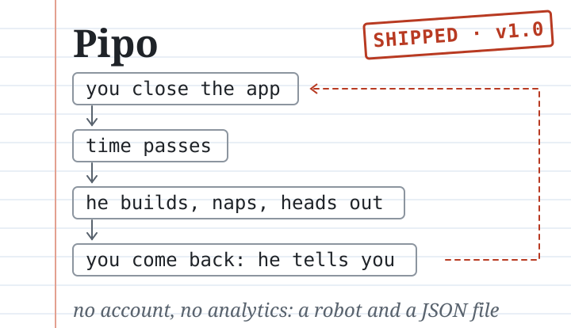
</picture>

**Pipo** `shipped · v1.0` · a little robot who lives in your phone · [get the APK](https://github.com/aspire488/Pipo/releases/tag/v1.0) · [source](https://github.com/aspire488/Pipo)

**Campus Bus** `shipped · v1.1` · bus seat booking for a college, Java + MySQL · 166 tests pass, tried on one PC so far · [Windows download](https://github.com/aspire488/campus-bus/releases/tag/v1.1) · [source](https://github.com/aspire488/campus-bus)

## In the workshop

<picture>
  <source media="(prefers-color-scheme: dark)" srcset="./assets/profile/kio.dark.svg">
  <source media="(prefers-color-scheme: light)" srcset="./assets/profile/kio.light.svg">
  
</picture>

**KIO** `building` · the kernel of my companion runtime, rebuilt one gate at a time · [source](https://github.com/aspire488/Kio)

<picture>
  <source media="(prefers-color-scheme: dark)" srcset="./assets/profile/uea.dark.svg">
  <source media="(prefers-color-scheme: light)" srcset="./assets/profile/uea.light.svg">
  
</picture>

**UEA** `alpha` · real tools for coding agents, so the model stops guessing what a tool can prove · token savings: not measured yet · [source](https://github.com/aspire488/Universal-Engineering-Augmentation)

<picture>
  <source media="(prefers-color-scheme: dark)" srcset="./assets/profile/aura.dark.svg">
  <source media="(prefers-color-scheme: light)" srcset="./assets/profile/aura.light.svg">
  
</picture>

**AURA** `built, not verified` · memory for KIO, last touched in June 2026 · [source](https://github.com/aspire488/AURA)

## Tools I made for myself

<picture>
  <source media="(prefers-color-scheme: dark)" srcset="./assets/profile/ghops.dark.svg">
  <source media="(prefers-color-scheme: light)" srcset="./assets/profile/ghops.light.svg">
  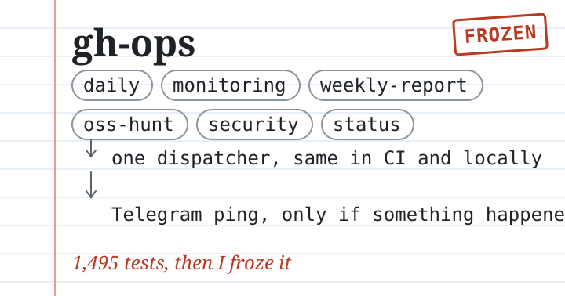
</picture>

**gh-ops** `frozen` · my GitHub chores on autopilot · [source](https://github.com/aspire488/gh-ops) · and [**OSS Atlas**](https://github.com/aspire488/oss-atlas), my running log of open-source work

older experiments: MediMind and CodeFlow (frozen prototypes, spring 2026)

 

- [MediMind](https://github.com/aspire488/medimind) · medication reminders for made-up patients, not a medical device · [demo](https://medimind-seven.vercel.app/)
- [CodeFlow](https://github.com/aspire488/codeflow) · teaches C by stepping through simple programs · [demo](https://codeflow-app-sigma.vercel.app)

## Other people's code

<picture>
  <source media="(prefers-color-scheme: dark)" srcset="./assets/profile/tally.dark.svg">
  <source media="(prefers-color-scheme: light)" srcset="./assets/profile/tally.light.svg">
  
</picture>

Tally redrawn from GitHub every hour. Merged into [PyRIT](https://github.com/microsoft/PyRIT/pull/2762), [Inspect AI](https://github.com/UKGovernmentBEIS/inspect_ai/pull/5670), [aios](https://github.com/eumemic/aios/pull/2457) and more. A maintainer also carried my [Hermes Agent fix](https://github.com/NousResearch/hermes-agent/pull/121771) into [#126144](https://github.com/NousResearch/hermes-agent/pull/126144), with credit. [See every PR, the closed ones too](https://github.com/search?q=is%3Apr+author%3Aaspire488+-user%3Aaspire488&type=pullrequests).

## The boring numbers

  

  <picture>
    <source media="(prefers-color-scheme: dark)" srcset="./assets/profile/overview.dark.svg">
    <source media="(prefers-color-scheme: light)" srcset="./assets/profile/overview.light.svg">
    
  </picture>

  <picture>
    <source media="(prefers-color-scheme: dark)" srcset="./assets/profile/contributions.dark.svg">
    <source media="(prefers-color-scheme: light)" srcset="./assets/profile/contributions.light.svg">
    
  </picture>

  <picture>
    <source media="(prefers-color-scheme: dark)" srcset="./assets/profile/activity.dark.svg">
    <source media="(prefers-color-scheme: light)" srcset="./assets/profile/activity.light.svg">
    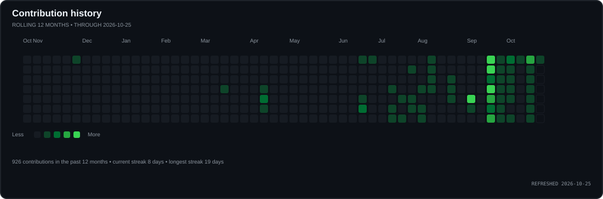
  </picture>

<strong>Open the deeper analytics</strong>: languages · contribution mix · weekly rhythm

 
<table>
<tr>
<td width="33%" valign="top">
<picture>
  <source media="(prefers-color-scheme: dark)" srcset="./assets/profile/languages.dark.svg">
  <source media="(prefers-color-scheme: light)" srcset="./assets/profile/languages.light.svg">
  
</picture>
</td>
<td width="33%" valign="top">
<picture>
  <source media="(prefers-color-scheme: dark)" srcset="./assets/profile/composition.dark.svg">
  <source media="(prefers-color-scheme: light)" srcset="./assets/profile/composition.light.svg">
  
</picture>
</td>
<td width="33%" valign="top">
<picture>
  <source media="(prefers-color-scheme: dark)" srcset="./assets/profile/rhythm.dark.svg">
  <source media="(prefers-color-scheme: light)" srcset="./assets/profile/rhythm.light.svg">
  
</picture>
</td>
</tr>
</table>

---

more pages coming. something on this desk is probably half-built right now 🛠️ · [all my repos](https://github.com/aspire488?tab=repositories) · [portfolio](https://aspire488.github.io/aspire488/)
