<!-- Profile README for aspire488 -->

  

  
  
  
  

## Hey, I'm Joel 👋

I'm a Computer Science Engineering student who builds software, explores systems design, and contributes to open source. My work ranges from desktop applications and Android projects to developer tooling, automation, and AI infrastructure.

I care about making software **useful, testable, and dependable**—not just getting a demo to run.

- 🧩 Building across application development, automation, and systems engineering
- 🌐 Contributing fixes and features to projects maintained by other teams
- 🧪 Prefer explicit tests, reproducible results, and honest project status
- 🚀 I ship projects, learn from feedback, and keep building

  
  

---

## 🚀 Featured Projects

A selection of shipped projects and ongoing engineering work. This is a curated list, not a ranking.

| Project | Overview | Status / links |
|---|---|---|
| 🚌 **[Campus Bus](https://github.com/aspire488/campus-bus)** | Java desktop reservation system with seat selection, student bookings, admin tools, PDF passes, and email confirmations. | **v1.1 · Windows x64** · [Release](https://github.com/aspire488/campus-bus/releases/tag/v1.1) · [Architecture](https://github.com/aspire488/campus-bus#9-architecture) · [Release audit](https://github.com/aspire488/campus-bus/blob/main/docs/final-release-audit.md) · **166/166 tests passed** |
| 🤖 **[Pipo](https://github.com/aspire488/Pipo)** | Android character with a procedural 2.5D world, routines, memory, activities, and a companion named Nib. | [Living world](https://aspire488.github.io/Pipo/) · [Latest release](https://github.com/aspire488/Pipo/releases/tag/v1.0) |
| ⚙️ **[KIO](https://github.com/aspire488/Kio)** | Modular orchestration runtime focused on capability routing, controlled execution, security gates, and verification. | Active restoration and integration |
| 🛠️ **[UEA](https://github.com/aspire488/Universal-Engineering-Augmentation)** | Agent-neutral engineering tools for code intelligence, analysis, verification, and deterministic workflows. | Public alpha · [CI](https://github.com/aspire488/Universal-Engineering-Augmentation/actions) |
| 🧠 **[AURA](https://github.com/aspire488/AURA)** | Memory and cognition backend for persistent agent state and retrieval. | Architecture checkpoint |
| ⚙️ **[gh-ops](https://github.com/aspire488/gh-ops)** | GitHub operations, CI/release monitoring, OSS intelligence, security signals, and Telegram reporting. | Frozen baseline · **1,495 tests passing** |
| 🌍 **[OSS Atlas](https://github.com/aspire488/oss-atlas)** | Archive and workspace for open-source contribution research and engineering notes. | Ongoing |
| ⚡ **[CodeFlow](https://github.com/aspire488/codeflow)** · 💊 **[MediMind](https://github.com/aspire488/medimind)** | Earlier prototypes in developer workflow and medication reminders. | Frozen prototypes |

---

## 🌐 Open-Source Contributions

I work on upstream fixes and features as well as carefully scoped fork-side proposals. **Merged, open, and fork-only work are kept separate.**

### Merged upstream

- **[Microsoft PyRIT #2976](https://github.com/microsoft/PyRIT/pull/2976)** — preserved word-selection parameters in StringJoinConverter identifiers, with regression tests.
- **[Microsoft PyRIT #2882](https://github.com/microsoft/PyRIT/pull/2882)** — rejected empty targets in ExactTextMatching, with regression coverage.
- **[Microsoft PyRIT #2823](https://github.com/microsoft/PyRIT/pull/2823)** — preserved HarmBench context in behavior prompts and metadata.
- **[Microsoft PyRIT #2762](https://github.com/microsoft/PyRIT/pull/2762)** — added memory-backed dataset summaries.
- **[Hermes Agent #127233](https://github.com/NousResearch/hermes-agent/pull/127233)** — corrected rendering of structured MCP get_prompt content.
- **[Inspect AI #5670](https://github.com/UKGovernmentBEIS/inspect_ai/pull/5670)** — fixed Google API key versus ADC precedence.

### Other work

- **[RAMPART contribution](https://github.com/aspire488/RAMPART/pull/2)** — generic PyRIT converter bridge proposal; open for review.
- **[Inspect AI #5671](https://github.com/UKGovernmentBEIS/inspect_ai/pull/5671)** and **[#5672](https://github.com/UKGovernmentBEIS/inspect_ai/pull/5672)** — draft proposals for structured tool validation and cached input-token preservation.

**View more:** [OSS Atlas — contribution archive, research, and engineering notes](https://github.com/aspire488/oss-atlas) · [All my pull requests](https://github.com/pulls?q=is%3Apr+author%3Aaspire488)

---

## 📌 Pinned Repositories

A quick route to the projects I want visitors to discover first:

  
  
  
  
  
  

> These links highlight the repositories in this README; manage the actual GitHub profile pins separately from [your pinned repositories settings](https://github.com/aspire488?tab=repositories).

---

## 🧰 Technologies

  

Technologies vary by project and include Python, Java, Kotlin, C, JavaScript, HTML/CSS, Android, Swing, FastAPI, GitHub Actions, MySQL, PostgreSQL, Redis, and MCP.

---

## 📊 GitHub Activity

  <picture>
    <source media="(prefers-color-scheme: dark)" srcset="./assets/profile/overview.dark.svg"/>
    <source media="(prefers-color-scheme: light)" srcset="./assets/profile/overview.light.svg"/>
    
  </picture>

  <picture>
    <source media="(prefers-color-scheme: dark)" srcset="./assets/profile/contributions.dark.svg"/>
    <source media="(prefers-color-scheme: light)" srcset="./assets/profile/contributions.light.svg"/>
    
  </picture>

  

---

## 🧠 How I Build

- **Deterministic software owns execution; AI handles ambiguity.**
- **Verification belongs in implementation, not just at the end.**
- **Claims should be backed by tests or observable evidence.**
- **Ship useful work, learn from review, and improve the system.**

  
  <strong>Building in public · Shipping software · Learning by doing</strong>

