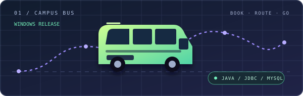
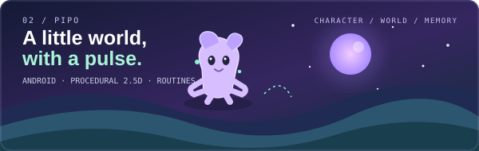
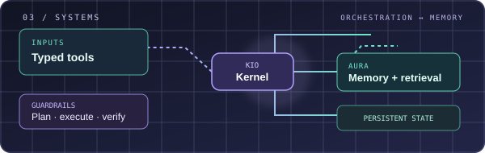
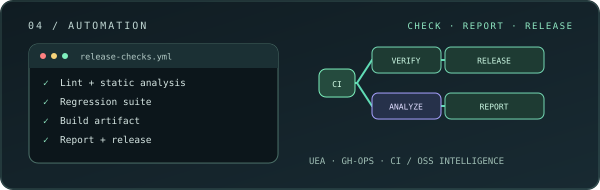

<!-- Profile README for aspire488 -->

<a href="https://github.com/aspire488?tab=repositories">PROJECTS</a>
&nbsp; ◈ &nbsp;
<a href="https://github.com/pulls?q=is%3Apr+author%3Aaspire488">OPEN SOURCE</a>
&nbsp; ◈ &nbsp;
<a href="https://joel-jigo-portfolio--joeljigo3.replit.app">PORTFOLIO</a>
&nbsp; ◈ &nbsp;
<a href="https://github.com/aspire488">GITHUB</a>

I'm a Computer Science Engineering student who builds across desktop and Android apps, developer tooling, automation, and AI infrastructure. I like taking ideas all the way to a working release—and fixing the details that make software dependable after the demo.

**My default loop:** understand the problem → design the boundary → build → test → ship → learn.

---

## Selected work

<table>
<tr>
<td width="50%" valign="top">

### [Campus Bus](https://github.com/aspire488/campus-bus)

A Java desktop reservation system for student seat bookings and admin fleet management, packaged for Windows with a private MySQL setup.

JAVA · SWING · JDBC · MYSQL

[Windows v1.1 release ↗](https://github.com/aspire488/campus-bus/releases/tag/v1.1) · [Source ↗](https://github.com/aspire488/campus-bus)

</td>
<td width="50%" valign="top">

### [Pipo](https://github.com/aspire488/Pipo)

An Android character experience with a procedural 2.5D world, routines, memory, activities, and a companion named Nib.

ANDROID · KOTLIN · PROCEDURAL WORLD

[Explore the live world ↗](https://aspire488.github.io/Pipo/) · [Release ↗](https://github.com/aspire488/Pipo/releases/tag/v1.0)

</td>
</tr>
<tr>
<td width="50%" valign="top">

### [KIO + AURA](https://github.com/aspire488/Kio)

A controlled orchestration runtime paired with a persistent memory and retrieval backend. Built around typed tools, explicit boundaries, and verification.

PYTHON · FASTAPI · CHROMADB · SYSTEMS DESIGN

[KIO source ↗](https://github.com/aspire488/Kio) · [AURA source ↗](https://github.com/aspire488/AURA)

</td>
<td width="50%" valign="top">

### [UEA + gh-ops](https://github.com/aspire488/Universal-Engineering-Augmentation)

Engineering tools and GitHub automation for code intelligence, CI and release monitoring, open-source discovery, and reporting.

PYTHON · GITHUB ACTIONS · AUTOMATION

[UEA + CI ↗](https://github.com/aspire488/Universal-Engineering-Augmentation) · [gh-ops ↗](https://github.com/aspire488/gh-ops)

</td>
</tr>
</table>

<strong>More projects and experiments</strong>

- [OSS Atlas](https://github.com/aspire488/oss-atlas) — open-source contribution research and engineering notes.
- [CodeFlow](https://github.com/aspire488/codeflow) — developer workflow prototype.
- [MediMind](https://github.com/aspire488/medimind) — medication reminder app prototype.

---

## Open source

I contribute focused fixes and features upstream, ideally with regression tests and a clear explanation of the behaviour being changed.

| Project | Selected contribution |
|---|---|
| [Microsoft PyRIT #2976](https://github.com/microsoft/PyRIT/pull/2976) | Preserved word-selection parameters in converter identifiers, with regression tests. |
| [Microsoft PyRIT #2882](https://github.com/microsoft/PyRIT/pull/2882) | Rejected empty targets in exact-text matching, with regression coverage. |
| [Microsoft PyRIT #2823](https://github.com/microsoft/PyRIT/pull/2823) | Preserved HarmBench context across behavior prompts and metadata. |
| [Inspect AI #5670](https://github.com/UKGovernmentBEIS/inspect_ai/pull/5670) | Fixed Google API key versus Application Default Credentials precedence. |
| [Hermes Agent #127233](https://github.com/NousResearch/hermes-agent/pull/127233) | Corrected rendering of structured MCP `get_prompt` content. |

<strong>More PRs and proposals</strong>

- [PyRIT #2762](https://github.com/microsoft/PyRIT/pull/2762) — memory-backed dataset summaries.
- [RAMPART #2](https://github.com/aspire488/RAMPART/pull/2) — generic PyRIT converter bridge proposal.
- [Inspect AI #5671](https://github.com/UKGovernmentBEIS/inspect_ai/pull/5671) and [#5672](https://github.com/UKGovernmentBEIS/inspect_ai/pull/5672) — draft proposals for structured tool validation and cached input-token preservation.

[All pull requests by aspire488 ↗](https://github.com/pulls?q=is%3Apr+author%3Aaspire488)

---

## Tool belt

<table>
<tr>
<td width="33%" valign="top">

<strong>LANGUAGES</strong>  Python · Java · C · JavaScript · Kotlin

</td>
<td width="33%" valign="top">

<strong>APPS &amp; APIS</strong>  Android · Swing · HTML/CSS · React · FastAPI · Node.js

</td>
<td width="33%" valign="top">

<strong>INFRASTRUCTURE</strong>  Git · Linux · GitHub Actions · Docker · PostgreSQL · Redis

</td>
</tr>
</table>

## How I work

<table>
<tr>
<td width="33%" valign="top">

<strong>01 / MAKE BOUNDARIES CLEAR</strong>  Typed interfaces, controlled execution, and small components beat hidden magic.

</td>
<td width="33%" valign="top">

<strong>02 / PROVE THE CLAIM</strong>  Regression tests and repeatable checks matter more than a confident status message.

</td>
<td width="33%" valign="top">

<strong>03 / SHIP AND ITERATE</strong>  Release useful work, learn from review, and follow through on the rough edges.

</td>
</tr>
</table>

---

## Contribution activity

Rendered from an SVG maintained in this repository. No external stats-card dependency.

---

## Connect

<a href="https://github.com/aspire488">GitHub</a>
&nbsp; · &nbsp;
<a href="https://github.com/pulls?q=is%3Apr+author%3Aaspire488">My pull requests</a>
&nbsp; · &nbsp;
<a href="https://joel-jigo-portfolio--joeljigo3.replit.app">Portfolio</a>
&nbsp; · &nbsp;
<a href="https://aspire488.github.io/Pipo/">Pipo's living world</a>

 

Build thoughtfully. Verify relentlessly. Ship things that matter.

