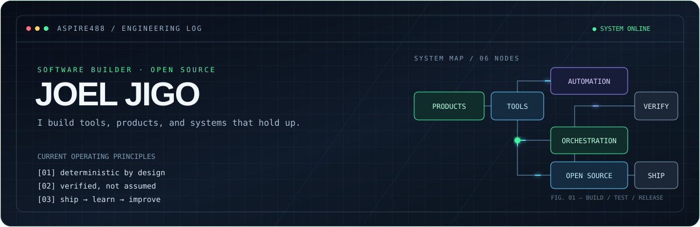

<!-- Profile README for aspire488 -->

[**Explore projects**](#-featured-work) &nbsp; ◈ &nbsp; [**Open-source work**](#-open-source-contributions) &nbsp; ◈ &nbsp; [**Engineering principles**](#-tech-stack) &nbsp; ◈ &nbsp; [**Contribution map**](#-github-activity) &nbsp; ◈ &nbsp; [**Connect**](#connect)

## `whoami`

I'm a Computer Science Engineering student who builds software across desktop apps, Android, developer tooling, automation, and AI infrastructure.

I care about software that is **useful, testable, and dependable**. I like taking projects from an idea to a working release, and contributing fixes upstream when I find something worth improving.

- 🔧 **Building:** applications, developer tools, and orchestration systems
- 🌐 **Contributing:** upstream fixes, features, and regression tests
- 🧪 **Engineering style:** reproducible tests, explicit boundaries, honest status
- 🚀 **Mindset:** ship, learn from review, improve

---

## 🚀 Featured work

<table>
<tr>
<td width="50%" valign="top">

### 🚌 [Campus Bus](https://github.com/aspire488/campus-bus)

Java desktop bus reservation system with student bookings, seat selection, admin tools, PDF passes, and email confirmations.

**[Windows v1.1 release](https://github.com/aspire488/campus-bus/releases/tag/v1.1)** · [Architecture](https://github.com/aspire488/campus-bus#9-architecture)

Reported release test run: 166/166 passing.

</td>
<td width="50%" valign="top">

### 🤖 [Pipo](https://github.com/aspire488/Pipo)

An Android character with a procedural 2.5D world, routines, memory, activities, and a companion named Nib.

[Explore the living world](https://aspire488.github.io/Pipo/) · [Latest release](https://github.com/aspire488/Pipo/releases/tag/v1.0)

</td>
</tr>
<tr>
<td width="50%" valign="top">

### ⚙️ [KIO](https://github.com/aspire488/Kio)

A modular orchestration runtime focused on capability routing, controlled execution, security gates, and verification.

</td>
<td width="50%" valign="top">

### 🧰 [UEA](https://github.com/aspire488/Universal-Engineering-Augmentation)

Agent-neutral engineering tools for code intelligence, analysis, verification, and deterministic workflows.

[Public alpha · CI](https://github.com/aspire488/Universal-Engineering-Augmentation/actions)

</td>
</tr>
<tr>
<td width="50%" valign="top">

### 🧠 [AURA](https://github.com/aspire488/AURA)

A memory and cognition backend for persistent agent state and retrieval.

</td>
<td width="50%" valign="top">

### 🛰️ [gh-ops](https://github.com/aspire488/gh-ops)

GitHub operations, CI/release monitoring, OSS intelligence, security signals, and Telegram reporting.

Frozen baseline · 1,495 tests passing in the recorded test run.

</td>
</tr>
</table>

<strong>Explore each project — architecture, focus, and links</strong>

🚌 <strong>Campus Bus</strong>

A Java desktop reservation system built around student booking and admin workflows.

- [Source code](https://github.com/aspire488/campus-bus)
- [Windows v1.1 release](https://github.com/aspire488/campus-bus/releases/tag/v1.1)
- [Architecture notes](https://github.com/aspire488/campus-bus#9-architecture)
- [Release audit](https://github.com/aspire488/campus-bus/blob/main/docs/final-release-audit.md)

🤖 <strong>Pipo</strong>

An Android character experience with a procedural 2.5D world, routines, memory, and companion Nib.

- [Repository](https://github.com/aspire488/Pipo)
- [Live world](https://aspire488.github.io/Pipo/)
- [Releases](https://github.com/aspire488/Pipo/releases)

⚙️ <strong>KIO + AURA</strong>

KIO focuses on controlled orchestration and verification; AURA provides persistent memory and retrieval.

- [KIO repository](https://github.com/aspire488/Kio)
- [AURA repository](https://github.com/aspire488/AURA)

🧰 <strong>UEA + gh-ops</strong>

Engineering tools, GitHub automation, CI/release monitoring, and open-source intelligence.

- [UEA repository and CI](https://github.com/aspire488/Universal-Engineering-Augmentation)
- [gh-ops repository](https://github.com/aspire488/gh-ops)

🌍 <strong>OSS Atlas, CodeFlow, MediMind</strong>

- [OSS Atlas](https://github.com/aspire488/oss-atlas) — contribution research and engineering notes.
- [CodeFlow](https://github.com/aspire488/codeflow) — developer workflow prototype.
- [MediMind](https://github.com/aspire488/medimind) — medication reminder prototype.

---

## 🌐 Open-source contributions

I work on upstream fixes and features as well as carefully scoped proposals. Merged, open, and draft work are kept separate.

<strong>Selected merged upstream work</strong>

- [Microsoft PyRIT #2976](https://github.com/microsoft/PyRIT/pull/2976) — preserved word-selection parameters in StringJoinConverter identifiers, with regression tests.
- [Microsoft PyRIT #2882](https://github.com/microsoft/PyRIT/pull/2882) — rejected empty targets in ExactTextMatching, with regression coverage.
- [Microsoft PyRIT #2823](https://github.com/microsoft/PyRIT/pull/2823) — preserved HarmBench context in behavior prompts and metadata.
- [Microsoft PyRIT #2762](https://github.com/microsoft/PyRIT/pull/2762) — added memory-backed dataset summaries.
- [Hermes Agent #127233](https://github.com/NousResearch/hermes-agent/pull/127233) — corrected rendering of structured MCP get_prompt content.
- [Inspect AI #5670](https://github.com/UKGovernmentBEIS/inspect_ai/pull/5670) — fixed Google API key versus ADC precedence.

<strong>Open and draft proposals</strong>

- [RAMPART #2](https://github.com/aspire488/RAMPART/pull/2) — generic PyRIT converter bridge proposal; open for review.
- [Inspect AI #5671](https://github.com/UKGovernmentBEIS/inspect_ai/pull/5671) and [#5672](https://github.com/UKGovernmentBEIS/inspect_ai/pull/5672) — draft proposals for structured tool validation and cached input-token preservation.

**Explore more:** [OSS Atlas](https://github.com/aspire488/oss-atlas) · [All my pull requests](https://github.com/pulls?q=is%3Apr+author%3Aaspire488) · [All repositories](https://github.com/aspire488?tab=repositories)

---

## 🧩 Tech stack

<strong>Open my engineering principles</strong>

| Principle | What it means in practice |
|---|---|
| Deterministic core | Software owns execution; AI handles ambiguity. |
| Verify continuously | Tests and checks belong throughout implementation, not only at the end. |
| Honest evidence | Claims are backed by tests, release notes, or observable results. |
| Ship and iterate | Release useful work, learn from review, improve the system. |

<strong>Tools I reach for</strong>

- **Languages:** Python, Java, C, JavaScript, Kotlin
- **Web / backend:** HTML, CSS, React, Node.js, FastAPI
- **Infrastructure:** GitHub Actions, Linux, Docker, PostgreSQL, Redis
- **Focus areas:** desktop/mobile apps, automation, orchestration, developer tooling

---

## 📈 GitHub activity

**A year of building, reviewing, fixing, and shipping.**

[Open the live GitHub contribution graph ↗](https://github.com/aspire488)

Contribution artwork is stored in this repository; the profile's visual identity does not depend on external stats-card services.

---

## Connect

Want to explore the code, review a contribution, or see what I'm building next?

**Building in public · Shipping software · Learning by doing**

