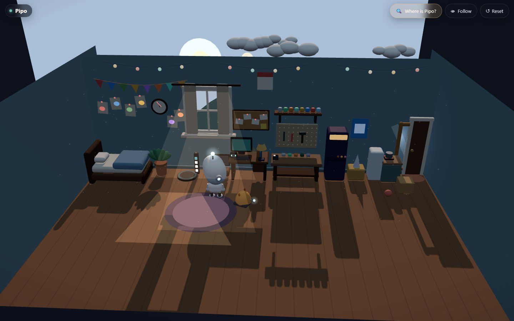

<!-- aspire488 · Field Atlas. Plates and cards in assets/profile are regenerated by .github/workflows/profile-cards.yml -->

<h1>Build things. Make them hold up.</h1>

**Joel Jigo** · computer science engineering student · Kochi, India

This is a dated survey of what I've built since March 2026, in the order it happened: two prototypes in the spring, a pair of systems over the summer, tooling and pull requests to other people's projects in September, and two releases in October.

Start with the releases, [**Pipo v1.0**](#pipo) and [**Campus Bus v1.1**](#campus-bus), or the [**upstream ledger**](#upstream).

<picture>
  <source media="(prefers-color-scheme: dark)" srcset="./assets/profile/atlas.dark.svg">
  <source media="(prefers-color-scheme: light)" srcset="./assets/profile/atlas.light.svg">
  
</picture>

Stations sit at the month of each project's first commit; the date beside one is its release or its last commit on the default branch. Filled: released · ring with dot: in development · dashed: frozen · hollow: no human commit on the default branch in 60 days · outer ring: a human, not bot, commit there in the last 14 days. Redrawn hourly from the GitHub API.

<strong>Route log</strong>: the map as a table

 

| First commit | Project | Kind | State its repository records |
| --- | --- | --- | --- |
| Mar 2026 | [MediMind](https://github.com/aspire488/medimind) | application | frozen prototype |
| Apr 2026 | [CodeFlow](https://github.com/aspire488/codeflow) | application | frozen prototype |
| Jun 2026 | [AURA](https://github.com/aspire488/AURA) | system | memory and reasoning layer, last commit 28 June |
| Jul 2026 | [KIO](https://github.com/aspire488/Kio) | system | gate C-4 next |
| Sep 2026 | [UEA](https://github.com/aspire488/Universal-Engineering-Augmentation) | tooling | public alpha v0.1.0 |
| Sep 2026 | [Upstream pull requests](#upstream) | upstream | see the ledger |
| Sep 2026 | [gh-ops](https://github.com/aspire488/gh-ops) | tooling | frozen, maintenance |
| Sep 2026 | [OSS Atlas](https://github.com/aspire488/oss-atlas) | tooling | notes on open-source work, updated daily |
| Sep 2026 | [Pipo](https://github.com/aspire488/Pipo) | application | released, v1.0 |
| Oct 2026 | [Campus Bus](https://github.com/aspire488/campus-bus) | application | released, v1.1 |

## Early experiments

<code>PLATE I</code> · MARCH–APRIL 2026

**[MediMind](https://github.com/aspire488/medimind)** set out to be a medication assistant for seniors, patients and caregivers, with an AI helper and a pill-dispenser bridge. What it implements is the reminder loop: reminders fire, are confirmed or snoozed, and never fire twice, on synthetic users only. [Demo ↗](https://medimind-seven.vercel.app/)

**[CodeFlow](https://github.com/aspire488/codeflow)** set out to teach C by showing pointers, recursion and loops as they run. What it implements is a line tracer for assignments, print statements and simple loops, plus step-through of pre-written traces; a small AST-based executor for the subset it teaches is written up as the next step, not built. [Demo ↗](https://codeflow-app-sigma.vercel.app)

Both were reopened on 10 and 21 September 2026 to set up or harden CI and add CodeQL, Dependabot and security headers, then frozen.

## Systems

<code>PLATE II</code> · JUNE–AUGUST 2026

<picture>
  <source media="(prefers-color-scheme: dark)" srcset="./assets/profile/systems.dark.svg">
  <source media="(prefers-color-scheme: light)" srcset="./assets/profile/systems.light.svg">
  
</picture>

- **[KIO](https://github.com/aspire488/Kio)**, the Kernel for Intelligent Orchestration, is the execution core of a personal companion runtime. It advances through gates its repository records: C-1 context, C-2 registry and C-3 planning are marked done, and C-4, response separation, is next. Its anchored summary records a Phase 0 that deleted 5,167 lines. KIO has no public README yet; its design documents are in the repository root.
- **[AURA](https://github.com/aspire488/AURA)** is the memory and reasoning layer designed to pair with it: episodic, semantic and working memory, beliefs, goals and reasoning traces behind a FastAPI service. Its last commit was on 28 June 2026, and bringing it into KIO is gate C-7 in KIO's plan.

## Tooling and upstream

<code>PLATE III</code> · SEPTEMBER–OCTOBER 2026

<picture>
  <source media="(prefers-color-scheme: dark)" srcset="./assets/profile/tooling.dark.svg">
  <source media="(prefers-color-scheme: light)" srcset="./assets/profile/tooling.light.svg">
  
</picture>

- **[UEA](https://github.com/aspire488/Universal-Engineering-Augmentation)** moves repeatable engineering checks out of model reasoning and into deterministic tools: tree-sitter analysis, blast-radius impact, property and mutation testing, Z3 constraints. It's a public alpha, validated in CI on Python 3.10 to 3.12, and its README lists token savings as "not currently measured".
- **[gh-ops](https://github.com/aspire488/gh-ops)** is my GitHub operations layer on GitHub Actions: monitoring, security, weekly reports and open-source scouting. It's frozen, and its README records 1,495 passing tests at the freeze.
- **[OSS Atlas](https://github.com/aspire488/oss-atlas)** holds my notes, case studies and research on open-source work.

### Upstream

Pull requests to repositories I don't own, from the GitHub API, redrawn every hour. Merged means merged by that project's maintainers; pull requests into my own repositories and forks aren't counted.

<picture>
  <source media="(prefers-color-scheme: dark)" srcset="./assets/profile/upstream.dark.svg">
  <source media="(prefers-color-scheme: light)" srcset="./assets/profile/upstream.light.svg">
  
</picture>

| Project | Merged pull request | What changed |
| --- | --- | --- |
| Microsoft PyRIT | [#2762](https://github.com/microsoft/PyRIT/pull/2762) | Added a dataset summary API. |
| Microsoft PyRIT | [#2823](https://github.com/microsoft/PyRIT/pull/2823) · [#2882](https://github.com/microsoft/PyRIT/pull/2882) · [#2976](https://github.com/microsoft/PyRIT/pull/2976) | Kept HarmBench context, fixed exact-text matching on an empty target, kept word-selection parameters in converter identifiers. |
| Inspect AI UK AISI | [#5670](https://github.com/UKGovernmentBEIS/inspect_ai/pull/5670) | An explicit Google API key now wins over ambient ADC credentials. |
| aios | [#2457](https://github.com/eumemic/aios/pull/2457) · [#2458](https://github.com/eumemic/aios/pull/2458) · [#2459](https://github.com/eumemic/aios/pull/2459) · [#2460](https://github.com/eumemic/aios/pull/2460) | Preserved finish reasons, truncation, timeout bounds and LiteLLM parameter translation across streaming and workflows. |
| Hermes Agent | [#126144](https://github.com/NousResearch/hermes-agent/pull/126144) | Maintainers merged my stale-gateway fix and its tests from [#121771](https://github.com/NousResearch/hermes-agent/pull/121771) into their own pull request, with credit. The ledger counts #121771 as closed, because that is its state. |

[Every pull request to other repositories ↗](https://github.com/search?q=is%3Apr+author%3Aaspire488+-user%3Aaspire488&type=pullrequests)

## Working applications

<code>PLATE IV</code> · RELEASED OCTOBER 2026

### Pipo

<code>RELEASED · v1.0 · 4 OCT</code> &nbsp; Android 8.0+ · Kotlin · Three.js on GitHub Pages

A small robot with moods, memories, habits and projects who lives in a room on your phone. Nothing runs constantly: when the app reopens, or an hourly worker fires, the time you were away is replayed through the same behaviour engine, so something has changed when you come back. Sometimes he isn't home, just a note on the door. No account and no analytics. The browser version is a Three.js room with a live day–night cycle and his pet robot, Nib.

[**Visit the room ↗**](https://aspire488.github.io/Pipo/) &nbsp;·&nbsp; [Android APK v1.0 ↗](https://github.com/aspire488/Pipo/releases/tag/v1.0) &nbsp;·&nbsp; [Source ↗](https://github.com/aspire488/Pipo)

 

### Campus Bus

<code>RELEASED · v1.1 · 18 OCT</code> &nbsp; Windows desktop · Java · Swing + JavaFX WebView · JDBC · MySQL 8

Seat reservation for a college transport office. Students find a bus by trip and stop, pick a seat on the bus map, and get a pass they can save as a PDF; the office manages buses, routes, timetables, students and reservations.

The Windows release is a 76 MB zip with its own Java 25 runtime built with `jlink`. Its setup script installs a private, per-user MySQL on port 3310 with no admin rights, gives every demo account a new random password, never prints one, and changes nothing when run again. The packaging script runs the tests before it builds the zip. The v1.1 zip was checked in a sandbox through first setup, a repeat setup, an interrupted setup, sign-in and shutdown; Windows 10 and a second PC were not tested.

[**Download v1.1 ↗**](https://github.com/aspire488/campus-bus/releases/tag/v1.1) &nbsp;·&nbsp; [Source ↗](https://github.com/aspire488/campus-bus) &nbsp;·&nbsp; [All screenshots ↗](https://github.com/aspire488/campus-bus/tree/main/docs/screenshots)

## Instruments

Rendered from GitHub data by this repository's workflow and committed as plain SVG. The overview card's pull request total includes pull requests to my own repositories; the upstream ledger above counts only other people's.

  

  <picture>
    <source media="(prefers-color-scheme: dark)" srcset="./assets/profile/overview.dark.svg">
    <source media="(prefers-color-scheme: light)" srcset="./assets/profile/overview.light.svg">
    
  </picture>

  <picture>
    <source media="(prefers-color-scheme: dark)" srcset="./assets/profile/contributions.dark.svg">
    <source media="(prefers-color-scheme: light)" srcset="./assets/profile/contributions.light.svg">
    
  </picture>

  <picture>
    <source media="(prefers-color-scheme: dark)" srcset="./assets/profile/activity.dark.svg">
    <source media="(prefers-color-scheme: light)" srcset="./assets/profile/activity.light.svg">
    
  </picture>

<strong>Open the deeper analytics</strong>: languages · contribution mix · weekly rhythm

 
<table>
<tr>
<td width="33%" valign="top">
<picture>
  <source media="(prefers-color-scheme: dark)" srcset="./assets/profile/languages.dark.svg">
  <source media="(prefers-color-scheme: light)" srcset="./assets/profile/languages.light.svg">
  
</picture>
</td>
<td width="33%" valign="top">
<picture>
  <source media="(prefers-color-scheme: dark)" srcset="./assets/profile/composition.dark.svg">
  <source media="(prefers-color-scheme: light)" srcset="./assets/profile/composition.light.svg">
  
</picture>
</td>
<td width="33%" valign="top">
<picture>
  <source media="(prefers-color-scheme: dark)" srcset="./assets/profile/rhythm.dark.svg">
  <source media="(prefers-color-scheme: light)" srcset="./assets/profile/rhythm.light.svg">
  
</picture>
</td>
</tr>
</table>

## Unsurveyed

<code>PLATE V</code> · AS OF THIS PAGE

Where the work is now: KIO, at gate C-4 · the open and draft pull requests on the ledger · Campus Bus v1.1, not yet tested on Windows 10 or a second PC. The map is redrawn every hour; this page is written by hand.

[**Repositories**](https://github.com/aspire488?tab=repositories) — everything on the map, with the READMEs that say what each project has and hasn't verified. 
[**Pull requests to other projects**](https://github.com/search?q=is%3Apr+author%3Aaspire488+-user%3Aaspire488&type=pullrequests) — open ones included. 
[**Portfolio**](https://aspire488.github.io/aspire488/) — the same work, with search and project detail pages.

Plates drawn by <a href="./scripts/render_profile_atlas.py"><code>scripts/render_profile_atlas.py</code></a> · cards by <a href="https://github.com/seijikohara/profile-cards-action">profile-cards-action</a>
