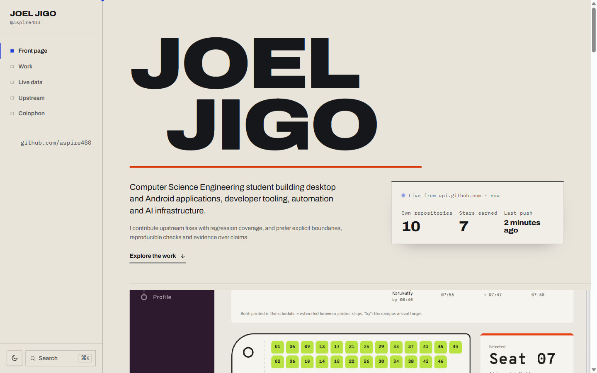

<!-- Profile README for aspire488 -->

<a href="https://github.com/aspire488?tab=repositories">PROJECTS</a>
&nbsp; / &nbsp;
<a href="https://github.com/pulls?q=is%3Apr+author%3Aaspire488">PULL REQUESTS</a>
&nbsp; / &nbsp;
<a href="https://aspire488.github.io/aspire488/">PORTFOLIO</a>

Computer Science Engineering student building desktop and Android applications, developer tools, automation, and AI infrastructure. I contribute upstream fixes with regression coverage, and prefer explicit boundaries, reproducible checks, and evidence over claims.

## The site

[**aspire488.github.io/aspire488**](https://aspire488.github.io/aspire488/) is the interactive edition of this profile: a filterable explorer over every project with real screenshots and repository evidence, live figures read from the GitHub API with an Actions-generated snapshot as fallback, a verified upstream pull-request ledger, a paper/ink theme switch, and a command palette on `⌘K` (or `/`). Built with Vite, React and TypeScript, tested in CI, and deployed by a dedicated GitHub Pages workflow.

---

## Selected work

<table>
<tr>
<td width="54%" valign="top">

### [Campus Bus](https://github.com/aspire488/campus-bus)

Desktop reservation software for student bus searches, seat selection, campus passes, and transport-office administration. Released as a self-contained Windows package.

JAVA · SWING · JDBC · MYSQL

[Windows release v1.1](https://github.com/aspire488/campus-bus/releases/tag/v1.1) · [Source code](https://github.com/aspire488/campus-bus)

</td>
<td width="46%" valign="top">

### [Pipo](https://github.com/aspire488/Pipo)

An Android character experience with a procedural 2.5D world, routines, memory, activities, and a companion named Nib.

The project includes a live browser-based world, classic 2D demo, and Android release.

ANDROID · KOTLIN · PROCEDURAL 2.5D

[Live world](https://aspire488.github.io/Pipo/) · [Classic demo](https://aspire488.github.io/Pipo/classic/) · [Release](https://github.com/aspire488/Pipo/releases/tag/v1.0)

</td>
</tr>
<tr>
<td width="50%" valign="top">

### [KIO + AURA](https://github.com/aspire488/Kio)

A modular orchestration runtime paired with a persistent memory and retrieval backend. Focused on typed tool contracts, controlled execution, lifecycle discipline, and verification.

PYTHON · FASTAPI · RETRIEVAL · SYSTEMS DESIGN

[KIO repository](https://github.com/aspire488/Kio) · [AURA repository](https://github.com/aspire488/AURA)

</td>
<td width="50%" valign="top">

### [UEA + gh-ops](https://github.com/aspire488/Universal-Engineering-Augmentation)

Engineering tools and GitHub automation for code analysis, tiered verification, CI and release monitoring, open-source discovery, and reporting.

PYTHON · GITHUB ACTIONS · AUTOMATION

[UEA and CI](https://github.com/aspire488/Universal-Engineering-Augmentation) · [gh-ops](https://github.com/aspire488/gh-ops)

</td>
</tr>
</table>

Other projects

- [OSS Atlas](https://github.com/aspire488/oss-atlas) — open-source contribution research and engineering notes.
- [CodeFlow](https://github.com/aspire488/codeflow) — developer workflow prototype.
- [MediMind](https://github.com/aspire488/medimind) — medication reminder app prototype.

---

## Open source

Selected upstream contributions, with an emphasis on correctness and regression coverage.

| Project | Contribution |
| --- | --- |
| [Microsoft PyRIT #2976](https://github.com/microsoft/PyRIT/pull/2976) | Preserved word-selection parameters in converter identifiers. |
| [Microsoft PyRIT #2882](https://github.com/microsoft/PyRIT/pull/2882) | Added validation for empty targets in exact-text matching. |
| [Microsoft PyRIT #2823](https://github.com/microsoft/PyRIT/pull/2823) | Preserved HarmBench context in prompts and metadata. |
| [Microsoft PyRIT #2762](https://github.com/microsoft/PyRIT/pull/2762) | Added memory-backed dataset summaries. |
| [Inspect AI #5670](https://github.com/UKGovernmentBEIS/inspect_ai/pull/5670) | Fixed API-key versus application-default-credentials precedence. |
| [Hermes Agent #127233](https://github.com/NousResearch/hermes-agent/pull/127233) | Corrected rendering of structured MCP prompt content. |

[All pull requests by aspire488](https://github.com/pulls?q=is%3Apr+author%3Aaspire488) · [OSS Atlas](https://github.com/aspire488/oss-atlas)

---

## Tools

<table>
<tr>
<td width="33%" valign="top">

<strong>LANGUAGES</strong>

Python · Java · C · JavaScript · Kotlin

</td>
<td width="33%" valign="top">

<strong>APPLICATIONS</strong>

Android · Swing · HTML/CSS · React · FastAPI · Node.js

</td>
<td width="33%" valign="top">

<strong>INFRASTRUCTURE</strong>

Git · Linux · GitHub Actions · Docker · PostgreSQL · Redis

</td>
</tr>
</table>

## Engineering principles

- **Clear boundaries:** typed interfaces and controlled execution over hidden side effects.
- **Verification:** regression tests and repeatable checks throughout implementation.
- **Evidence:** claims backed by releases, test results, or observable behaviour.
- **Iteration:** ship useful work, respond to review, improve the implementation.

---

## Contribution activity

<a href="https://github.com/aspire488">View GitHub profile and live contribution graph</a>

---

<a href="https://github.com/aspire488">GitHub</a>
&nbsp; · &nbsp;
<a href="https://github.com/pulls?q=is%3Apr+author%3Aaspire488">Pull requests</a>
&nbsp; · &nbsp;
<a href="https://aspire488.github.io/aspire488/">Portfolio</a>

